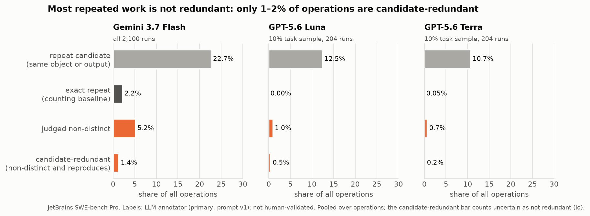
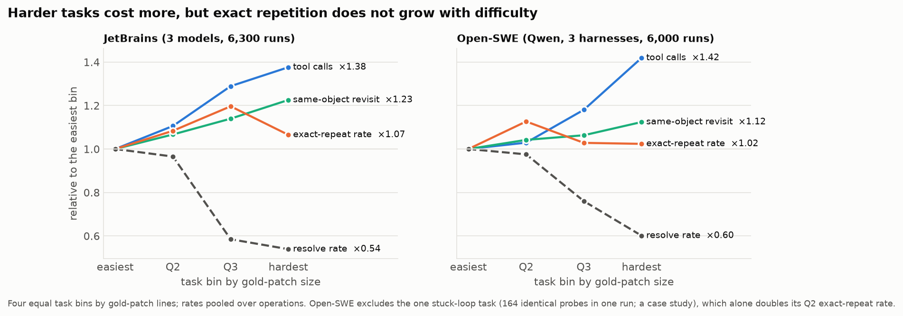
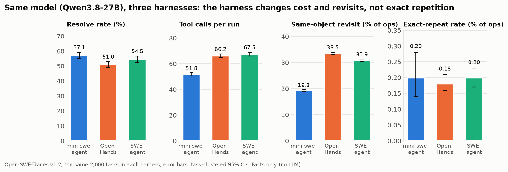
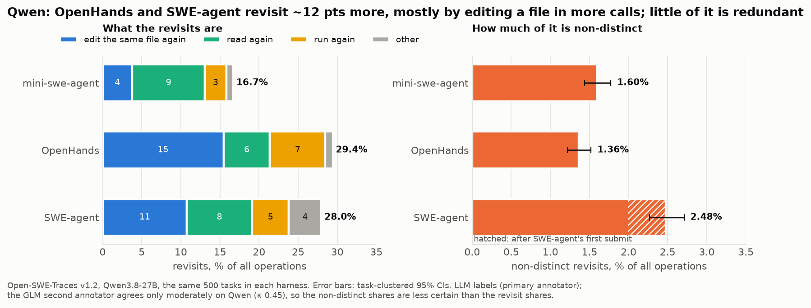
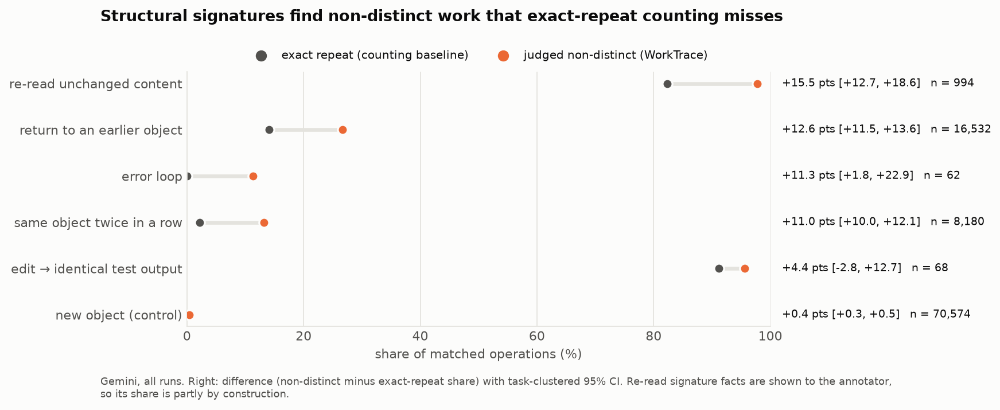
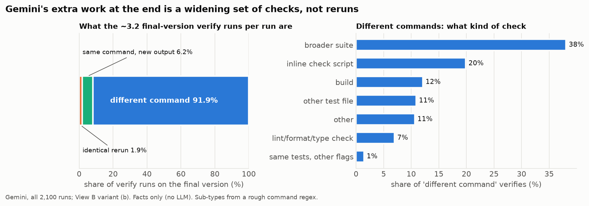
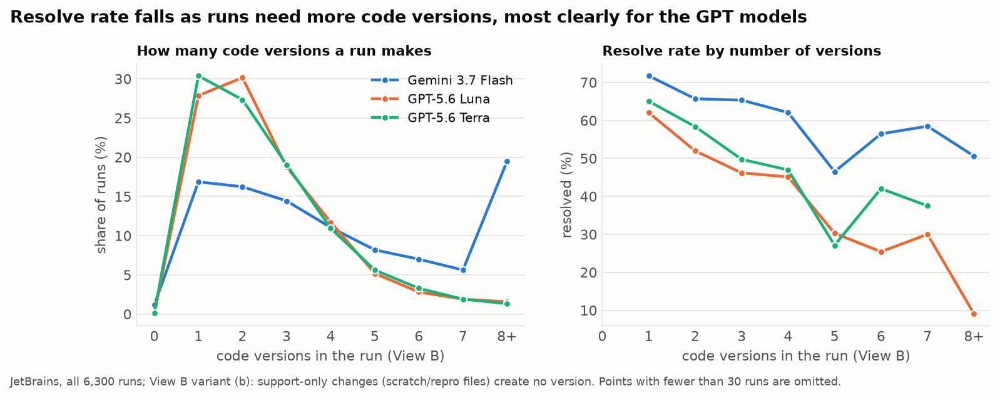
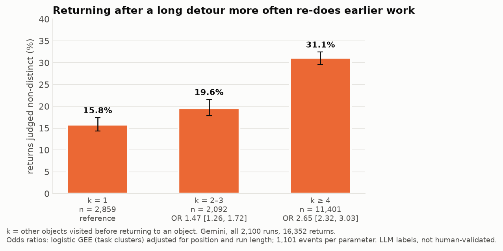

# WorkTrace: all results so far, and is it promising? (interim, 2026-10-25)

Scope:
- **Data:**
  - 6,300 JetBrains SWE-bench Pro runs (3 models × 700 tasks × 3 runs), facts only.
  - A 50-run pilot with every operation LLM-labelled.
  - Proxy validation: a second annotator, self-consistency, and CodeTraceBench.
  - Open-SWE-Traces v1.2: 6,000 Qwen3.8-27B runs (2,000 tasks × 3 harnesses), facts only, plus a 60-run labelled pilot.
  - Qwen main run: 500 tasks × 3 harnesses, all matched ops LLM-labelled, plus GLM on 1,000 ops (`results/v2/qwen/main/SUMMARY.md`).
- **Still to come:** human labels (B.8).
- **Validation status:** nothing is human-validated. Labels come from LLM annotators, and all checks are automated audits by a third model (Claude).
- **Figures:** all figures below are generated by `worktrace/scripts/v2_overview_figures.py` from result files in the repository.

## Short verdict
- **The method works.** Facts, labels, graphs and signatures are reproducible, and model–model agreement is decent.
- **But the paper as planned ("much repeated work is redundant, and patterns explain it") is not supported so far.**
  - Redundant work is rare in this data.
  - What repetition there is is mostly *useful* verification and refinement.
- **The most promising story is the reverse claim:**
  - Repeat counts overstate waste, because most repetition is purposeful.
  - Agents converge by linear refinement and then verify the final code with a widening set of checks.
  - WorkTrace is the tool that can show this. A counting tool cannot.
- **The Open-SWE harness comparison is now in and does not change the picture:**
  - With the model fixed, no harness wastes much: non-distinct revisits are 1.4–2.5% of ops.
  - OpenHands' and SWE-agent's extra revisits are mostly editing a file in more calls.
- **Human labels (B.8) could still change it.**

## 1. How much repetition is there? (Section 3, facts only)
| Model | Resolve | Tool calls per run | Exact-repeat rate | Same-object revisit |
|---|---|---|---|---|
| Gemini 3.7 Flash | 60.0% | 53.1 | 2.21% [2.08, 2.35] | 21.0% |
| GPT-5.6 Luna | 50.0% | 17.6 | 0.02% | 11.1% |
| GPT-5.6 Terra | 54.2% | 19.0 | 0.05% | 9.4% |

- **Exact repeats are rare.** They are essentially absent for the GPT models.
- **The planned "repetition grows with difficulty" claim is not supported.** From the easiest to the hardest bin, the exact-repeat rate is flat (0.70% → 0.75%) while tool calls rise 1.38×.

- **Open-SWE (Qwen3.8-27B, same 2,000 tasks in each harness; `results/v2/task5/BENCHMARK.md`):**

  | Harness | Resolve | Tool calls | Exact-repeat (run mean) | Same-object revisit |
  |---|---|---|---|---|
  | mini-swe-agent | 57.1% | 51.8 | 0.20% | 19.3% |
  | OpenHands | 51.0% | 66.2 | 0.18% | 33.5% |
  | SWE-agent | 54.5% | 67.5 | 0.20% | 30.9% |

  - With the model fixed, the harness barely changes exact repetition. It does change cost and revisits.
  - Exact repetition is again flat with difficulty.
  - One stuck-loop run (164 identical probes, all with empty output) is a case study, not a pattern.

- **Promising?** ✗ for a "lots of waste" headline.

## 2. How much repeated work is redundant? (pilot, LLM labels)
- **Matched ops** (ops with a repeat candidate): 22.7% [16.7, 29.6] are judged non-distinct.
- **Across all ops** that falls to 3.6%.
- **Candidate-redundancy rate** (non-distinct and reproducing earlier work, as a share of all ops), as a range across both annotators and both ways of counting `uncertain`:

| Model | Range |
|---|---|
| Gemini | 1.9% – 2.4% |
| Luna | 1.4% |
| Terra | 0.0% |
| All | 1.1% – 1.2% |

- **At scale** (all 2,100 Gemini runs; 10% Luna/Terra samples; single annotator, lo – hi; `results/v2/task6/SUMMARY.md`):

  | Model | Candidate-redundancy rate | Non-distinct share of matched ops |
  |---|---|---|
  | Gemini | 1.32% – 1.66% | 23.0% |
  | Luna | 0.48% | 8.0% |
  | Terra | 0.16% | 6.8% |

  The pilot's picture holds.
- **No low-contribution tail:** 0 ops after the last distinct op in every Gemini pilot run; at scale, 0.4% of Gemini runs have any tail.
- **Annotator robustness is good:** the range barely moves between annotators.
- **Qwen, 500 tasks × 3 harnesses** (`results/v2/qwen/main/SUMMARY.md`):
  - **Revisits judged non-distinct:** 9.6% (mini-swe-agent), 4.6% (OpenHands), 8.9% (SWE-agent).
  - **As a share of all ops:** 1.60%, 1.36% and 2.48%. Paired on task, OpenHands is −0.2 pts and SWE-agent +0.9 pts against mini-swe-agent.
  - **Why the revisit gap:** OpenHands and SWE-agent revisit about 12 pts more because `str_replace_editor` makes one change per call. Edit revisits are 15.5% and 10.8% of ops, against 3.8% for mini-swe-agent. Read revisits are not higher.
  - **SWE-agent after its first submit:** every run continues (the harness returns a review checklist), for about 4 ops per run. Those ops are 4× as dense in non-distinct work (8.4% vs 2.2% of ops) and account for about half of SWE-agent's excess.
  - **Annotator range:** the GLM second annotator agrees less on Qwen (κ 0.45 vs 0.70 on JetBrains). The candidate-redundancy rate is 0–0.9% of ops across annotators, and both annotators put SWE-agent highest.

- **Promising?** ✓ the measure is robust. ✗ there is little redundancy to explain.

## 3. Does WorkTrace see something exact repeats miss? (signatures)
- **All Gemini runs (Task 6), non-distinct share minus exact-repeat share:**

  | Signature | Gap | n |
  |---|---|---|
  | `reread_unchanged` | +15.5 pts [12.7, 18.6] | 994 |
  | `return_any` | +12.6 pts [11.5, 13.6] | 16,532 |
  | `self_repeat` | +11.0 pts [10.0, 12.1] | 8,180 |

  The pilot's +75 for `reread_unchanged` (n = 11) was inflated.

- **Promising?** ✓ Structure adds information beyond counting, now with real n. The gaps are moderate (11–16 pts), not dramatic.

## 4. What do runs look like structurally? (View B code-version graph, all 6,300 runs)
- **Mostly linear refinement.**
  - Gemini 4.8 code versions per run, Luna and Terra 2.6.
  - Backtracks occur in ≤3.7% of runs.
  - The LLM `version_move` label calls 0.6% of changes `branch_out`; 80% are `correct` and 17% `support` (scratch and repro files).
- **Gemini verifies late and broadly:**
  - 3.2 verify runs on the final version vs 0.7 on each earlier version.
  - 55% of all its verifies land on the final version.
  - 92% of those final verifies are *different* commands (broader suites, other tests, check scripts, lint, builds).
  - Only 1.9% are identical reruns.

- **Resolve rate falls with more versions:** 72% for 1 version, 45–58% for 5–8.

- **Error Loop** (3+ consecutive ops with the same error): about 1% of runs.
- **Qwen (View B, 500 tasks × 3 harnesses):**
  - **Versions per run (6–14) track edit calls one to one,** so they reflect each harness's edit granularity.
  - **Apparent backtracks** (36–45% of runs) are 96–98% `git stash && test; git stash pop` checks of the original code. Real backtracks occur in 1–2% of runs.
  - **Verification is spread through the run:** 14–29% of verifies are on the final version, against 55% for Gemini.
  - **Error loops:** 4–7% of runs, short (about 3 ops), and almost never judged non-distinct.
- **Promising?** ✓ A clean, TRACE-style picture (Late-Landing-like) with a clear message: the extra work at the end is verification, not waste.

## 5. Return-after-k (Task 3)
- **Model:** logistic GEE, `non_distinct ~ k + position + log length + model`.
- **Re-run on all Gemini runs (Task 6):** 4,405 events, about 1,100 events per parameter, against about 5 in the pilot.
  - k ≥ 4 vs k = 1: OR 2.65 [2.32, 3.03].
  - k = 2–3: OR 1.47 [1.27, 1.72].
  - Adjusted for position and run length; the raw non-distinct share is 16% → 20% → 31% by k.
- **The effect is real but much smaller than the pilot's OR of 14–33.** Later returns are less often non-distinct.
- **Qwen does not show it.** The OR for k ≥ 4 is 1.06 (mini-swe-agent), 1.48 [1.07, 2.05] (OpenHands) and 1.16 (SWE-agent), at 79–151 events per parameter. The effect is model-specific: clear for Gemini, weak or absent for Qwen.
- **Promising?** ✓ A robust, interpretable structural effect: returning after long detours re-does work.

## 6. Are the labels trustworthy? (proxies; human labels pending)
- **Second annotator (GLM-5.3-flash), matched ops:** κ = 0.70 on contribution, 0.83 on candidate redundancy.
- **Self-consistency (T = 0.7, 3 samples):** κ ≈ 0.88–0.90.
- **CodeTraceBench** (human "unuseful" labels): WorkTrace P 3.5% / R 27.5% vs exact repeat P 5.6% / R 33.3%.
  - Not better than the baseline.
  - Its labels mostly mark planning repeats and empty actions, a different construct. Only 32 of its 69 labelled steps are repeats at all.
- **Promising?** ✓ the labels are stable. ? external validity is unshown, and human validation is still pending.

## What would make it promising for the original framing
1. **Open-SWE shows a harness with clearly more redundant work** under the same model. **Not found.**
   - SWE-agent has a small, real excess: +0.9 pts of ops, half of it from the post-submit checklist segment.
   - No harness wastes much.
2. **Human labels agree** with the LLM labels (B.8 sample ready in `annotation/pilot.csv`).
3. **The full Gemini set makes the return-after-k and `reread_unchanged` effects robust.** Done (Task 6): both hold, with smaller effect sizes than the pilot.

(1) did not hold, so the stronger paper is a measurement paper: "repetition ≠ waste".
- **Claim:** recent agents waste little.
- **Evidence:**
  - their repetition is refinement and verification;
  - counting tools mislabel it.
- **Caveat:** the interventions (Section 5.3) would then have little to remove.

## Where to look
| Topic | File |
|---|---|
| v1 pilot | `RESULTS.md` |
| v2 relabel | `results/v2/task2/SUMMARY.md` |
| View B | `results/v2/viewb/SUMMARY.md`, figures `figures/v2/viewb_patterns_*_support.png` |
| Verify classes | `results/v2/reconcile/SUMMARY.md` |
| version_move | `results/v2/prompt_v2/V2_1_RESULTS.md` |
| Return-after-k | `results/v2/task3/SUMMARY.md` (pilot), `results/v2/task6/SUMMARY.md` (all Gemini) |
| Validation proxies | `results/v2/task4/SUMMARY.md`, `results/v2/B10_STATUS.md` |
| Open-SWE choice | `results/v2/task5/RECOMMENDATION.md` |
| Open-SWE benchmark | `results/v2/task5/BENCHMARK.md` |
| Qwen pilot | `results/v2/qwen/pilot/SUMMARY.md` |
| Qwen main run (5 analyses, GLM range) | `results/v2/qwen/main/SUMMARY.md` |
