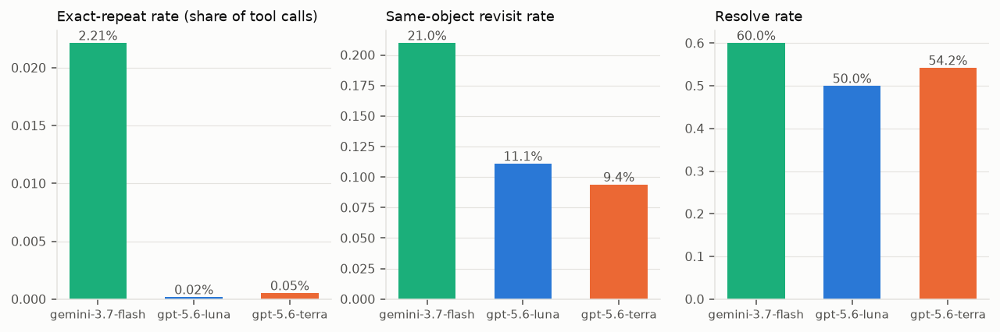
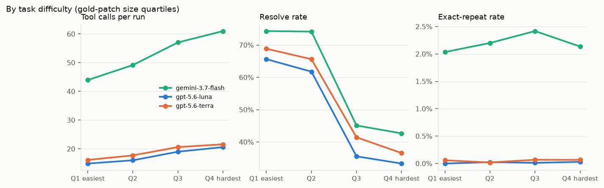
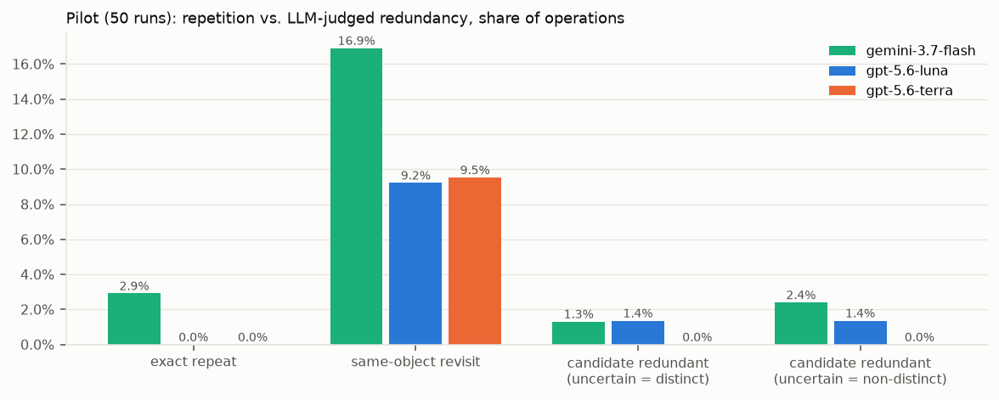
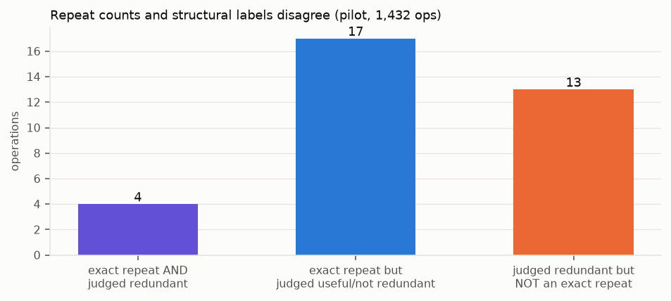
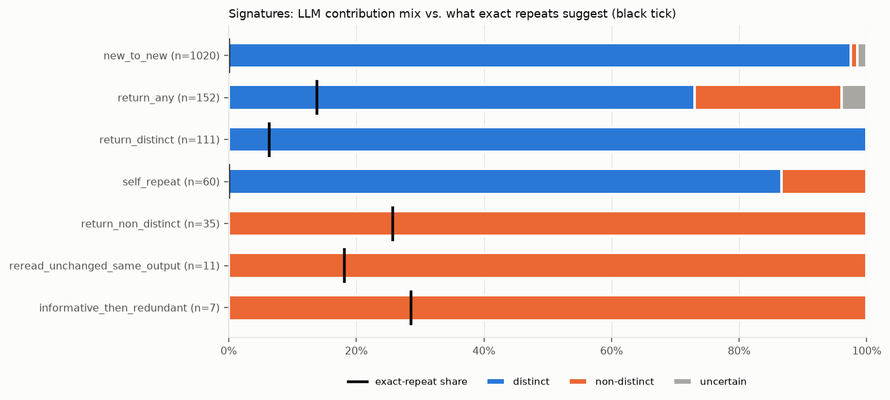
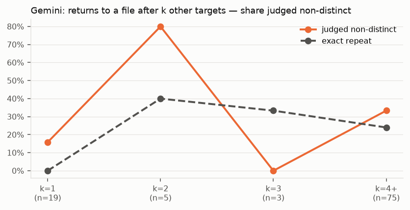
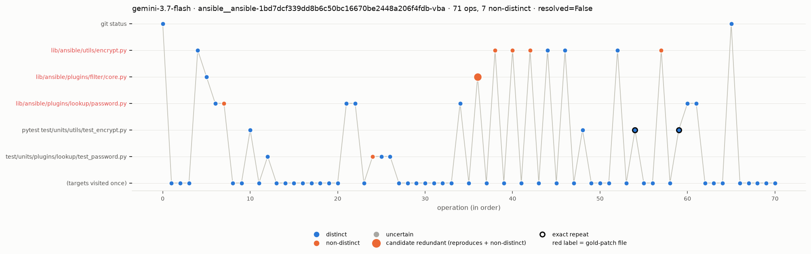
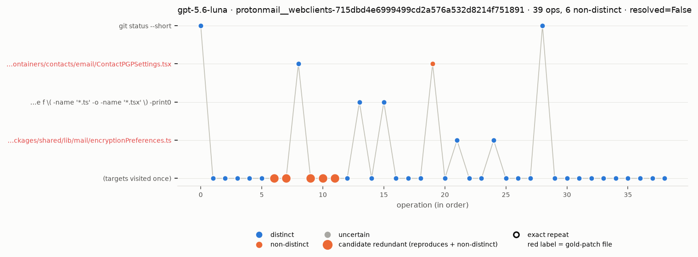
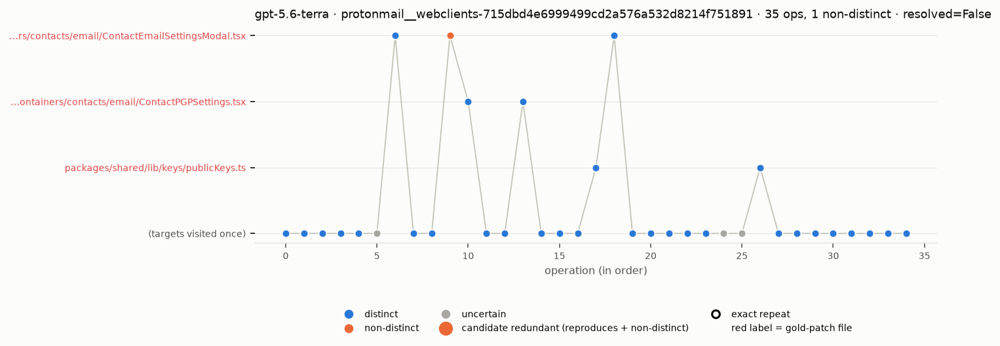

# WorkTrace pilot — results (2026-10-24)

Code: `worktrace/` (see `worktrace/README.md` for commands and deviations). All numbers regenerate from the scripts.

## Section 3 benchmark — all 6,300 JetBrains SWE-bench Pro runs (no LLM)

| Model | Resolve | Turns | Tool calls | Input tok | Exact-repeat rate [95% CI] | Same-object revisit | Runs with ≥1 exact repeat |
|---|---|---|---|---|---|---|---|
| Gemini 3.7 Flash | 60.0% | 53.0 | 53.1 | 3.34M | 2.21% [2.08, 2.35] | 21.0% | 62.0% |
| GPT-5.6 Luna | 50.0% | 13.3 | 17.6 | 0.25M | 0.02% [0.00, 0.03] | 11.1% | 0.3% |
| GPT-5.6 Terra | 54.2% | 12.5 | 19.0 | 0.24M | 0.05% [0.03, 0.07] | 9.4% | 1.0% |

Resolve rates reproduce the dataset card. 0 infrastructure drops; gold patches joined for 93.9% of runs.

Difficulty (4 equal task bins, all models pooled): tool calls rise 25.0 → 34.4 (1.38×) from easiest to hardest
gold-patch-size bin while resolve rate falls 69.6% → 37.5%, but the **exact-repeat rate is flat (0.70% → 0.75%)**.
The same holds within Gemini (2.0% → 2.1%) and on empirical difficulty. The draft's "repetition grows with
difficulty" claim is **not supported** on this source; only same-object revisits rise slightly (12.6% → 15.7%).

## Pilot — 50 runs (17 tasks × 3 models), 1,432 operations, every op LLM-labeled

- Labels: 99.8% valid on first pass or after retries (3 label errors → uncertain). Contribution: 1,357 distinct /
  54 non-distinct / 21 uncertain. Relation: 1,216 unmatched / 187 revisits / 17 reproduces / 12 uncertain.
- Candidate-redundancy rate (reproduces ∧ non-distinct), lo–hi range: Gemini 1.3–2.4%, Luna 1.4%, Terra 0%.
- Low-contribution tail: mean 0–0.06 ops per run for every model; late non-distinct rate: Gemini 4.1–9.3%, others ≤ 2%.
  → **Test Looper is not supported** by this data (the draft pre-registers that outcome).
- Exact repeats vs. structure (the key comparison): of 21 exact repeats only 4 are candidate-redundant; 13
  candidate-redundant ops are *not* exact repeats. Typical case: test reruns with identical output after an edit are
  judged *distinct* (they verify changed code); re-reads of unchanged content via a different command
  (`cat` vs `sed -n`) are judged non-distinct.
- Return-after-k (Gemini): non-distinct share 16% at k=1 (n=19), 33% at k≥4 (n=75); k=2–3 bins have n ≤ 5, so no reliable trend yet.

Only the fact-defined signatures are evidence here; `return_distinct`, `return_non_distinct` and
`informative_then_redundant` are defined by the labels themselves.

### Redundancy labelling of individual runs

Each dot is one operation in order (x) on its work target (y). Colour is the LLM's contribution label, the grey line
is the agent's path (a line going back up is a return to an earlier file or test), a black ring marks an exact
repeat, a large dot marks a candidate-redundant operation, and red row labels are gold-patch files. Targets visited
only once share the bottom row. Shown: the run with the most non-distinct operations for each model.

**Gemini 3.7 Flash** — repeated returns to `encrypt.py` (ops 38–57), several judged non-distinct; the two exact
repeats (ringed test reruns) were judged *distinct* because code changed in between.

**GPT-5.6 Luna** — five candidate-redundant ops (ops 6–11) sit on the "visited once" row: different `grep`
commands that each failed with the same BusyBox `--include` error. Exact-repeat counting misses them because the
commands differ; they were matched on identical output.

**GPT-5.6 Terra**

All 50 runs can be browsed interactively in `viewer/index.html` (hover a step to see the command, output and label).

## Go / no-go (B.10)

| Criterion | Status |
|---|---|
| 1. Human–human κ ≥ 0.6 | **Pending** — 200-item blind sample exported to `annotation/pilot.csv` |
| 2. Model–human macro-F1 ≥ 0.7, precision ≥ 0.8 | **Pending** — run `scripts/m5_annotation.py agree` after labeling |
| 3. Uncertain share of matched ops ≤ 20% | **Pass** — 4.9% |
| 4. A signature ≥ 10 pts away from exact repeats | **Pass, but thin** — `reread_unchanged_same_output` 100% non-distinct vs 18% exact (n = 11); `self_repeat` 13 pts (n = 60); `return_any` 9 pts (n = 152) |

> **v2 update (2026-10-24):** criteria 1–2 are replaced by proxies for now, and human validation is still pending. See `results/v2/B10_STATUS.md`. The v1 table above is unchanged.

LLM-only baseline (no facts/candidates, 224 matched ops): contribution agreement 77% (κ 0.34), relation agreement
44% (κ 0.08) → the rule facts change the labels substantially.

## Caveats

- Criterion 4's strongest signature uses the same facts the annotator is shown (same output, object unwritten), so
  its 100% non-distinct share is partly by construction; human labels are needed to make it evidence.
- Code state goes "unknown" after inline `python - <<PY` / `python -c` scripts (mostly real edits): 24 of 30 test
  reruns with a prior run could not be confirmed as "unchanged code", so `edit_test_identical_test` has 0 matches.
  Needs better write detection (parse `write_text`/`open(...,'w')` targets) before M9.
- Open-SWE-Traces (cross-harness) not included: download too slow from this machine. Open-SWE now also has a v2.0.
- Annotator: deepseek-v4.1-flash via SoCLaaS `x-test-2`, reasoning "low" for matched ops, off for unmatched.
