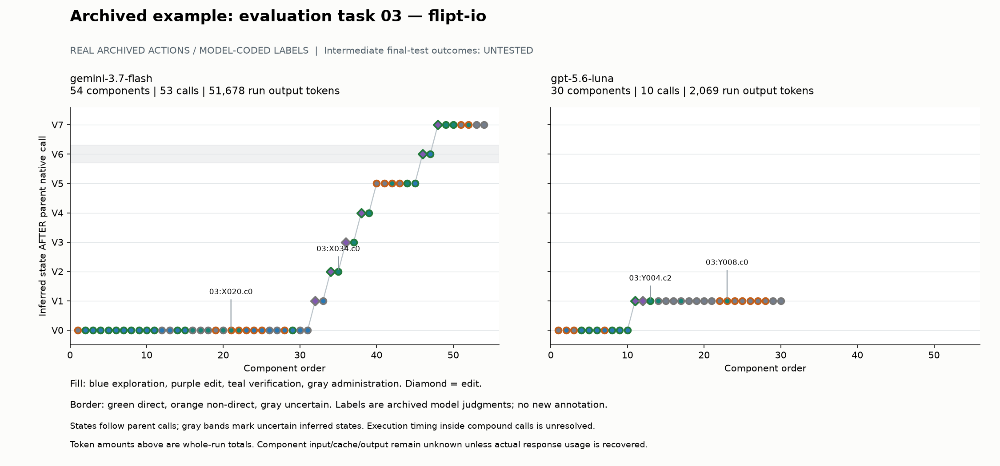
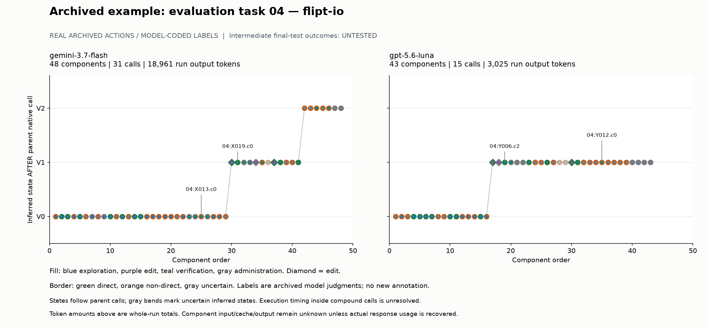

# One-hour framework smoke study

Real archived examples and an executable reduced sample. This is development evidence, not a model ranking.

Selection: first two frozen evaluation orders [3, 4]; four runs. No selection by observed redundancy.

| Task order | Model | Components | Native calls | Run input | Cached input | Run output |
| --- | --- | ---: | ---: | ---: | ---: | ---: |
| 3 | gemini-3.7-flash | 54 | 53 | 3,448,740 | 3,200,762 | 51,678 |
| 3 | gpt-5.6-luna | 30 | 10 | 100,650 | 87,377 | 2,069 |
| 4 | gemini-3.7-flash | 48 | 31 | 951,973 | 760,343 | 18,961 |
| 4 | gpt-5.6-luna | 43 | 15 | 137,056 | 124,650 | 3,025 |

Input/cache/output are separate archived run fields. These amounts do not attribute cost to roles or components.

## Role contribution bounds

Known unexecuted candidates are excluded; uncertain execution remains as in the archived convention. Bounds reflect uncertain labels, not confidence intervals.

| Task | Model | Role | Included | Direct | Non-direct | Uncertain | Precision bounds |
| --- | --- | --- | ---: | ---: | ---: | ---: | --- |
| 3 | gemini-3.7-flash | exploration | 26 | 15 | 4 | 7 | 57.7%–84.6% |
| 3 | gemini-3.7-flash | verification | 14 | 6 | 4 | 4 | 42.9%–71.4% |
| 3 | gpt-5.6-luna | exploration | 8 | 6 | 2 | 0 | 75.0%–75.0% |
| 3 | gpt-5.6-luna | verification | 4 | 1 | 1 | 2 | 25.0%–75.0% |
| 4 | gemini-3.7-flash | exploration | 19 | 7 | 10 | 2 | 36.8%–47.4% |
| 4 | gemini-3.7-flash | verification | 12 | 3 | 4 | 5 | 25.0%–66.7% |
| 4 | gpt-5.6-luna | exploration | 12 | 7 | 5 | 0 | 58.3%–58.3% |
| 4 | gpt-5.6-luna | verification | 6 | 4 | 1 | 1 | 66.7%–83.3% |

## Trajectory examples





## Component examples

First executed direct and non-direct verification examples per selected run. Qualitative illustrations, not prevalence estimates. The same-family model reviews are not human ground truth.

### 03:X034.c0 — gemini-3.7-flash, direct

```bash
go test -v ./internal/server/middleware/grpc ./internal/server/auth
```

Archived reason: new_relevant_coverage

Archived evidence: 03:X034.c0 `go test -v ./internal/server/middleware/grpc ./internal/server/auth`. Existing TestErrorUnaryInterceptor and TestUnaryInterceptor package tests pass after mapper/auth changes; their read tables cover ordinary error codes and successful/skipped authentication on the changed paths. Agent-visible output was truncated; no hidden/elided output is credited.

Component usage: input=None, cache=None, output=None; attribution=unavailable.

### 03:X020.c0 — gemini-3.7-flash, non_direct

```bash
go test ./internal/server ./internal/server/audit/... ./internal/server/cache/... ./internal/server/metadata/... ./internal/server/metrics/... ./internal/server/otel/...
```

Archived reason: baseline_no_solution_link

Archived evidence: 03:X020.c0 `go test ./internal/server ./internal/server/audit/... ./internal/server/cache/... ./internal/server/metadata/... ./internal/server/metrics/... ./internal/server/otel/...`. Broad baseline server/storage/cache testing provides no actionable context defect; Redis container failures are environmental and filesystem/auth store passes do not test the new mapping. This is baseline context without a demonstrated regression comparison used by the repair; non-direct is not a claim that an earlier completed check was repeated.

Component usage: input=None, cache=None, output=None; attribution=unavailable.

### 03:Y004.c2 — gpt-5.6-luna, direct

```bash
git diff -- internal/server/middleware/grpc/middleware.go internal/server/auth/middleware.go
```

Archived reason: new_relevant_coverage

Archived evidence: 03:Y004.c2 `git diff -- internal/server/middleware/grpc/middleware.go internal/server/auth/middleware.go`. Diff shows context switch branches and auth propagation only, retaining existing status forwarding and ordinary token failures; first structural confirmation of these edits.

Component usage: input=None, cache=None, output=None; attribution=unavailable.

### 03:Y008.c0 — gpt-5.6-luna, non_direct

```bash
cat patch.txt
```

Archived reason: repeated_support

Archived evidence: 03:Y008.c0 `cat patch.txt`. Patch content duplicates Y4 diff with no intervening source edit; confirms serialization but adds no behavioral coverage.

Component usage: input=None, cache=None, output=None; attribution=unavailable.

### 04:X019.c0 — gemini-3.7-flash, direct

```bash
go test -v ./config/...
```

Archived reason: new_relevant_coverage

Archived evidence: 04:X019.c0 `go test -v ./config/...`. Existing config TestLoad/validation/ServeHTTP pass after loader/struct changes, including field equality for default and deprecated fixtures; relevant preservation on changed state.

Component usage: input=None, cache=None, output=None; attribution=unavailable.

### 04:X013.c0 — gemini-3.7-flash, non_direct

```bash
go test ./server/... ./errors/... ./rpc/... ./storage/cache/...
```

Archived reason: baseline_no_solution_link

Archived evidence: 04:X013.c0 `go test ./server/... ./errors/... ./rpc/... ./storage/cache/...`. Baseline tests pass existing config/server/RPC/cache behavior; pool/meta missing-key assertions are not present and no baseline defect drives the edit. This is baseline context without a demonstrated regression comparison used by the repair; non-direct is not a claim that an earlier completed check was repeated.

Component usage: input=None, cache=None, output=None; attribution=unavailable.

### 04:Y006.c2 — gpt-5.6-luna, direct

```bash
git diff -- config/config.go
```

Archived reason: new_relevant_coverage

Archived evidence: 04:Y006.c2 `git diff -- config/config.go`. Visible diff confirms new typed pool fields, IsSet keys and Default false. This establishes implementation structure and the chosen resolution of meta-default tension.

Component usage: input=None, cache=None, output=None; attribution=unavailable.

### 04:Y012.c0 — gpt-5.6-luna, non_direct

```bash
sed -n '1,220p' patch.txt
```

Archived reason: repeated_support

Archived evidence: 04:Y012.c0 `sed -n '1,220p' patch.txt`. Patch text repeats already inspected config diff; no source change since Y6.

Component usage: input=None, cache=None, output=None; attribution=unavailable.

## Pipeline coverage

- Real source/component/response identity joins: checked on this subset.
- Existing classification and contribution labels: reused, no independent semantic validation.
- Response resource accounting: not run empirically; local raw usage absent.
- Intermediate complete snapshots and final-test outcomes: not evaluated by this script.
- Actual post-pass expenditure: unresolved until evaluated checkpoints and response usage are joined.
- Synthetic accounting CLI tests pass separately; they cannot fill the missing empirical stages.

Use CODEX_FRAMEWORK_ONE_HOUR.md to finish bounded raw-resource and checkpoint stages on the data machine.
