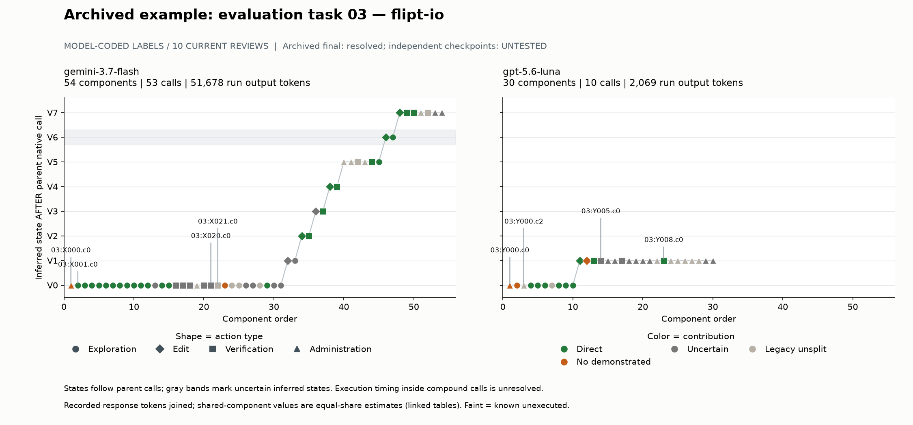
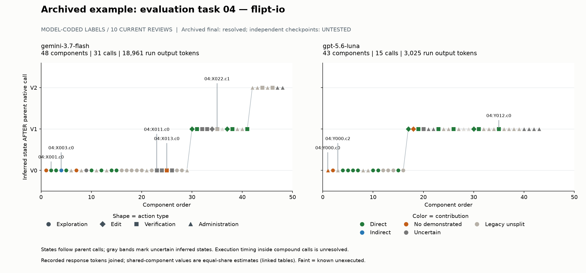

# Fixed two-task contribution and resource smoke study

This run recovered actual response tokens and completed the fixed 20-case model review. Checkpoint evaluation is **unavailable**, so the empirical pipeline is partial and post-pass spending remains unknown. This is a development smoke study, not human validation or a model ranking.

## Fixed sample and resources

Frozen evaluation orders 03/04, Gemini/Luna run 1: **175 candidates, 109 native calls, 104 stored generating responses**. No sample expansion, additional paid annotator, live agent run, dataset download or task-image build occurred.

| Task | Model | Candidates | Calls | Responses | Input | Cached input | Output | Run USD (source) |
| --- | --- | --- | --- | --- | --- | --- | --- | --- |
| 3 | gemini-3.7-flash | 54 | 53 | 53 | 3,448,740 | 3,200,762 | 51,678 | 0.61983300 (trajectory_tokens_litellm_public_map) |
| 3 | gpt-5.6-luna | 30 | 10 | 8 | 100,650 | 87,377 | 2,069 | 0.00688494 (harbor_agent_result) |
| 4 | gemini-3.7-flash | 48 | 31 | 31 | 951,973 | 760,343 | 18,961 | 0.27185200 (trajectory_tokens_litellm_public_map) |
| 4 | gpt-5.6-luna | 43 | 15 | 12 | 137,056 | 124,650 | 3,025 | 0.00860420 (harbor_agent_result) |

**All 12 input/cache/output reconciliations match exactly** (four runs × three fields; difference zero). Each of 104/104 responses and 175/175 candidates has these three token fields. Cached input is a reported subset of input; raw total_tokens equals input + output for every response. Do not add cache to input or reasoning details to output. Raw cache-write details remain in the ledger without being silently folded into cached input.

There are 0 stored no-tool responses, 0 stored error responses, and stored response counts equal api_calls in each run. All 104 provider response IDs are absent. Canonical IDs use run + stored response order and map every native call; the available traces cannot exclude unrecorded provider retries. Empty/missing future usage would stay null, never be inferred from run totals.

Luna has **20/20 harness-recorded per-response extra.cost values** that sum to its two run totals. These are recorded harness costs, not independently verified invoices. Gemini has zero placeholders in extra.cost while run cost_source is trajectory_tokens_litellm_public_map and run totals are nonzero; Gemini response/component USD stays null. No run cost was spread over responses. See [reconciliation](reviewed/resources/run_usage_reconciliation.jsonl) and [resource coverage](resource_coverage.csv).

Every response budget is conserved across **all** emitted candidates, including known unexecuted ones. Shared response values use 1/k equal-share **allocated estimates**; singleton values are response-associated, not measured causal reasoning cost. Here 98/175 candidates use shared-response estimates and 77/175 have singleton response association. No-tool expenditure would remain unassigned. Separate input/cache/output/USD, allocation methods, source IDs and review status are in [component_usage.csv](component_usage.csv); role/contribution and whole-response mixed sensitivities are in [region_totals.jsonl](reviewed/resources/region_totals.jsonl). Target history is explicitly unknown; command recurrence means an identical earlier emitted command in that run and does not determine contribution.

## Bounded contribution review

**20/20 prepared cases reviewed** (11.4% of all candidates; 11.6% of the 172 precision-included candidates). The current Codex session inspected complete task requirements, actual prompts, relevant full agent-visible observations/later trajectory and all four final patches. Reviewer: **Codex (model identifier unavailable), model, retrospective and unblinded**. No independent or human validation is claimed. The original source labels are unchanged and retained in archived_contribution_label; the completed review is an additive overlay.

D=direct, I=indirect, Z=no demonstrated contribution, U=uncertain, L=unreviewed legacy non_direct. The enriched packet cannot estimate population category prevalence or independent annotation accuracy.

### Reviewed subset only

| Task | Model | N | D | I | Z | U | Direct bounds |
| --- | --- | --- | --- | --- | --- | --- | --- |
| 3 | gemini-3.7-flash | 5 | 2 | 0 | 2 | 1 | 40.0%–60.0% |
| 3 | gpt-5.6-luna | 5 | 2 | 0 | 3 | 0 | 40.0%–40.0% |
| 4 | gemini-3.7-flash | 5 | 1 | 1 | 3 | 0 | 20.0%–20.0% |
| 4 | gpt-5.6-luna | 5 | 2 | 0 | 3 | 0 | 40.0%–40.0% |

Reviewed totals: **D=7, I=1, Z=11, U=1**. Direct bounds on this enriched subset are 35.0–40.0%, a feasibility description rather than a population estimate. Four direct controls remain direct; one uncertain control becomes direct and three become Z; twelve legacy cases become D=2/I=1/Z=8/U=1.

### Partially reviewed full runs

| Task | Model | N | D | I | Z | U | L | Reviewed | Direct bounds |
| --- | --- | --- | --- | --- | --- | --- | --- | --- | --- |
| 3 | gemini-3.7-flash | 54 | 26 | 0 | 2 | 15 | 11 | 5 | 48.1%–75.9% |
| 3 | gpt-5.6-luna | 30 | 9 | 0 | 3 | 10 | 8 | 5 | 30.0%–63.3% |
| 4 | gemini-3.7-flash | 47 | 12 | 1 | 3 | 9 | 22 | 5 | 25.5%–44.7% |
| 4 | gpt-5.6-luna | 41 | 14 | 0 | 3 | 7 | 17 | 5 | 34.1%–51.2% |

All-candidate counts (175): **D=61/I=1/Z=11/U=41/L=61**. Precision excludes 3 known unexecuted candidates, leaving 172 with **D=61/I=1/Z=11/U=41/L=58**. Of these, 19 have uncertain execution and remain included under the archived convention; [confirmed-execution sensitivity](confirmed_execution_sensitivity.csv) separately reports only the 153 confirmed executed components. Label bounds are D/N to (D+U)/N; I and Z get no direct credit. L stays unsplit and is excluded from the possible-direct numerator conditional on retaining its archived non-direct judgment. Bounds are not confidence intervals and do not cover systematic label, role or execution error.

### Exploration and verification: partial full-run bounds

| Task | Model | Role | N | D | I | Z | U | L | Reviewed | Direct bounds |
| --- | --- | --- | --- | --- | --- | --- | --- | --- | --- | --- |
| 3 | gemini-3.7-flash | exploration | 26 | 16 | 0 | 1 | 6 | 3 | 3 | 61.5%–84.6% |
| 3 | gemini-3.7-flash | verification | 14 | 6 | 0 | 0 | 5 | 3 | 1 | 42.9%–78.6% |
| 3 | gpt-5.6-luna | exploration | 8 | 6 | 0 | 1 | 0 | 1 | 2 | 75.0%–75.0% |
| 3 | gpt-5.6-luna | verification | 4 | 2 | 0 | 0 | 2 | 0 | 1 | 50.0%–100.0% |
| 4 | gemini-3.7-flash | exploration | 19 | 7 | 1 | 2 | 1 | 8 | 4 | 36.8%–42.1% |
| 4 | gemini-3.7-flash | verification | 12 | 3 | 0 | 1 | 5 | 3 | 1 | 25.0%–66.7% |
| 4 | gpt-5.6-luna | exploration | 12 | 7 | 0 | 1 | 0 | 4 | 2 | 58.3%–58.3% |
| 4 | gpt-5.6-luna | verification | 6 | 5 | 0 | 0 | 1 | 0 | 1 | 83.3%–100.0% |

Role-specific results on only reviewed cases are saved separately in [reviewed_subset_by_run.csv](reviewed/reviewed_subset_by_run.csv), including undefined empty-role denominators. Roles outside this review remain archived model judgments. Verification includes required saved-artifact integrity checks under H2; these bounds are not test-only behavioral precision.

## Evidence-linked examples

All 20 original/reviewed judgments, assessed observations and exact source hashes appear in [review_evidence.md](review_evidence.md) and the [overlay](contribution_review_completed.jsonl). Complete requirements and final/reference patches are in [task_context.md](task_context.md).

### 03:X011.c0: uncertain → direct

`grep -rn "context.Canceled\|context.DeadlineExceeded" .`

X011 successfully searches the repository for both context.Canceled and context.DeadlineExceeded; its complete agent-visible result contains only oplock testing references to cancellation and no production deadline handling. X008's earlier Canceled-only search did not establish the deadline half. Combined with X003/X004's observed mapper/auth source, this is scoped negative evidence of missing explicit deadline handling, addressed by X031/X033 and the surviving X047/final branches. It does not prove every possible equivalent idiom absent.

Input/cache/output = 28,528 / 24,313 / 544; USD=unavailable; single_component_response_association (weight 1; displayed shares rounded, full values in CSV).

### 04:X003.c0: non_direct → indirect

`ls -la config/ config/testdata/config/`

The ls component of X003 identifies advanced.yml, default.yml and deprecated.yml in config/testdata/config. In the next actual response, X004 explicitly says `Now that I have a map of the configuration files, my next logical step is to delve into the specific details of the test data` and reads exactly those three fixtures. Those later performed direct components establish configured/default/deprecated inputs relevant to R4. The directory metadata alone does not establish configuration semantics, so the observed navigation dependency earns indirect rather than direct credit. Links retain their archived direct status and are not additional new reviews.

Input/cache/output = 1,295.17 / 0 / 54.83; USD=unavailable; equal_share_response_allocation (weight 0.166667; displayed shares rounded, full values in CSV).

### 03:Y008.c0: non_direct → direct

`cat patch.txt`

The actual user message requires creating patch.txt, inspecting that file in a separate call, and confirming only intended source changes before submission. Y007 first serializes the worktree diff; Y008.c0 is the first read of that artifact and visibly contains the two source-file headers and context-mapping/auth edits matching the final submission. Y004.c2 inspected a live worktree diff, not the saved submission artifact. This narrow artifact-integrity contribution is direct under H2; it is not additional behavioral coverage and should not be called repeated-support over-verification. Separate header-check components receive no extra credit from this review.

Input/cache/output = 2,608 / 2,574.50 / 17.33; USD=0.00007899; equal_share_response_allocation (weight 0.166667; displayed shares rounded, full values in CSV).

### 04:Y012.c0: non_direct → direct

`sed -n '1,220p' patch.txt`

The actual user message explicitly requires inspecting saved patch.txt in a separate command after creation. Y011 creates that artifact; Y012.c0 is its first content read and visibly verifies the single config/config.go patch contains the new pool fields/getters and false update default, matching the final submission. Y006.c2's earlier diff inspected worktree state rather than the serialized artifact. Direct credit is for this specific submission-integrity requirement, not new execution/behavior evidence or automatic credit for every patch reread.

Input/cache/output = 2,918.40 / 2,871.60 / 25.20; USD=0.00009703; equal_share_response_allocation (weight 0.2; displayed shares rounded, full values in CSV).

### 04:X013.c0: non_direct → no_demonstrated

`go test ./server/... ./errors/... ./rpc/... ./storage/cache/...`

X013 passes existing server/RPC/cache tests before X018's sole config edit. These results do not exercise the new database fields, optional-key mapping or absent update flag, and the later trace does not use this baseline in a repair decision or an observed before/after preservation comparison for those packages. X019 checks config and X021 builds the executable separately. This is an assessed baseline without demonstrated solution contribution, not repeated support or an environment failure.

Input/cache/output = 31,587 / 28,356 / 91; USD=unavailable; single_component_response_association (weight 1; displayed shares rounded, full values in CSV).

### 03:X020.c0: non_direct → uncertain

`go test ./internal/server ./internal/server/audit/... ./internal/server/cache/... ./internal/server/metadata/... ./internal/server/metrics/... ./internal/server/otel/...`

Before source edits, X020 passes server/audit/memory-cache packages but Redis checks fail because Docker is unavailable. X021's next recorded explanation explicitly uses that diagnosis to select non-Docker tests. That is an observed testing decision, not repeated deterministic verification. However X021 is an unreviewed legacy component, and neither a specific repaired property checked here nor a supported dependency to later directly contributing work is established. Direct versus indirect usefulness remains unresolved; the environment failure is not itself proof of no contribution.

Input/cache/output = 46,099 / 40,515 / 325; USD=unavailable; single_component_response_association (weight 1; displayed shares rounded, full values in CSV).

### 04:Y006.c1: uncertain → no_demonstrated

`gofmt -w config/config.go`

Y006.c0's Python edit supplies the fields/getters/default change. gofmt runs before the visible diff and timed-out test, but the trace establishes no formatting-related defect, behavior change or required formatting property repaired by this component. The combined diff cannot independently attribute the semantic repair to gofmt. The later default tests/probe are separate components. This judgment does not mark the whole timed-out parent call unexecuted.

Input/cache/output = 1,754.33 / 1,588 / 153.33; USD=0.00024903; equal_share_response_allocation (weight 0.166667; displayed shares rounded, full values in CSV).

The first-artifact inspections challenge the earlier repeated-support interpretation: unchanged source does not mean the saved submission artifact was already inspected. Conversely, no demonstrated task contribution in a baseline check does not establish repetition. The environment diagnostic is uncertain rather than automatically labeled waste. Only the prepared cases were re-reviewed; the remaining legacy checks cannot support a new repeated-support rate.

## Checkpoints and post-pass spending

Task 03 only: six priority slots (final, initial, first recoverable edited state different from final for each run); **0 actual evaluations attempted, 0 PASS, 0 semantic FAIL**. Docker was reachable, but none of the 46 installed image tags matches the pinned Flipt task; there is no configured final-protocol adapter or complete pinned task checkout. Setup stopped without image builds/downloads or host execution of trajectory commands. See [environment evidence](checkpoint_environment.json), [six unevaluated slots](checkpoint_evaluations.jsonl), and [checkpoint summary](checkpoint_summary.json). All snapshot/protocol/environment hashes remain null because no exact evaluated snapshot exists.

The six slots are not evaluations or reconstructed versions. Their component boundaries remain unknown. Maximum allowed executions was six with 120 seconds each and two concurrent containers; zero were launched. Archived final resolved=True remains a separate historical field, not an independently established PASS. **Earliest evaluated passing version and all post-pass input/cache/output/cost are unavailable.** No safe savings, stopping policy or intermediate correctness is inferred. Unknown no-tool timing and response-crossing boundaries would need explicit mixed/allocated sensitivity if evaluation became available.

## Trajectory figures

Each pair uses fixed-size markers: circle exploration, diamond edit, square verification, triangle administration. Green D, blue I, orange Z, gray U; beige is explicitly **unreviewed legacy unsplit**, a review status rather than a fifth v2 contribution category. States are inferred AFTER parent native calls; compound-call internal states are unresolved. Gray bands mark uncertain inferred states. All independent checkpoint outcomes are UNTESTED. Token triplets and evidence links are provided in the component table rather than marker size.

## Stage status and checks

| Stage | Status | Evidence / limitation |
| --- | --- | --- |
| Fixed identity join / token conservation | real-data tested | 175 candidates / 109 calls / 104 responses; exact token reconciliation |
| 20-case v2 overlay | real-data tested | Current-session model judgments; evidence/provenance and dependency schema checks, not semantic/human accuracy |
| Resource costs | real-data tested, partial | Luna recorded response cost; Gemini missing response cost; shares allocated |
| Trajectory figures | real-data tested | Actual actions and joined usage; inferred parent-call states |
| Missing/no-tool/shared/mixed accounting, zero-role bounds | synthetic-only tested for absent cases | Empirical subset has no no-tool/missing token responses; existing authored tests cover these cases |
| Checkpoint outcome gate / pass→fail / recovery | synthetic-only tested | Authored fixtures validate bookkeeping; no empirical outcomes |
| Exact reconstruction / final benchmark / post-pass spending | unavailable | Task image, pinned complete checkout and final-protocol adapter absent |

Recorded test results: [tests.txt](tests.txt); original audit probes: [audit_checks.txt](audit_checks.txt); restore-scope probes: [restore_scope_checks.txt](restore_scope_checks.txt). Synthetic fixtures are code checks and never appear as task outcomes.

The bounded pipeline successfully joins real response expenditure to all components and supports auditable four-label review. The strongest observation is accounting-level: response token sums reconcile exactly, while the evidence review distinguishes a supported indirect navigation step, a first submission-artifact check, and an unresolved environment diagnostic that the old binary label merged. Final quality/reference conflicts and the lack of checkpoint evaluation prevent model ranking or post-pass waste claims. The next necessary test is to supply the pinned task-03 image and final benchmark adapter, verify exact final reconstruction first, then evaluate the fixed initial/intermediate slots under the same protocol; independent review remains necessary for semantic validation.

Started 2026-10-26T18:30:55+00:00; benchmark cutoff 2026-10-26T19:13:55+00:00; report deadline 2026-10-26T19:30:55+00:00. Report generated 2026-10-26T18:51:45.100922+00:00 (20.8 minutes elapsed). Benchmark setup closed at 2026-10-26T18:39:25.872980+00:00, before cutoff. See manifest for sources and commands.
