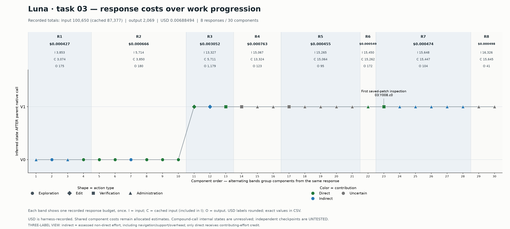

# Luna task 03: three-label direct-effort annotation

**30 components reviewed: 10 direct, 10 indirect, 10 uncertain.** No no_demonstrated or legacy-unsplit category appears in this view. This is a separate user-requested interpretation, not an independent validation study. The prior four-label outputs remain unchanged.

## Definition

- **Direct:** establishes a requirement-bearing observation, implements relevant source/delivery work, or verifies a supported repair/preservation/delivery property. Receives direct contributing-effort credit.
- **Indirect:** assessed effort without established direct contribution, including navigation, context gathering, formatting, repeated checking and operational scaffolding. Receives no direct-effort credit. This broader bucket does **not** imply proven causal guidance or useful marginal gain.
- **Uncertain:** execution, observed result or contribution cannot reliably be established. Retained as uncertainty rather than forced into indirect.

The ten former no_demonstrated judgments fall into this broader indirect bucket after reassessment; the direct and uncertain sets remain unchanged. Negative search results can be indirect, or direct when they themselves establish a missing required behavior. Chronological proximity alone does not prove guidance.

Direct component precision: **33.3%–66.7%** (D/N to (D+U)/N). There are 22 confirmed-executed components: **45.5%–54.5%** as a separate sensitivity. Eight components have uncertain execution and two invoked tests lack results. Roles and execution statuses retain their prior provenance.

| Role | N | Direct | Indirect | Uncertain | Direct bounds |
| --- | ---: | ---: | ---: | ---: | --- |
| exploration | 8 | 6 | 2 | 0 | 75.0%–75.0% |
| edit | 2 | 1 | 1 | 0 | 50.0%–50.0% |
| verification | 4 | 2 | 0 | 2 | 50.0%–100.0% |
| administration | 16 | 1 | 7 | 8 | 6.2%–56.2% |

## Concrete decisions

- The broad file listing Y000.c1 and dependency inventory Y002.c0 are indirect orientation/context effort.
- Formatting Y004.c1, repeated header checks Y008.c2/c3, and display separators are indirect support/overhead in this version. They do not receive direct credit.
- Y007.c0 creates the required saved patch and Y008.c0 first inspects that artifact: direct delivery contribution.
- Y005/Y006 tests time out without results: uncertain, not automatically indirect or proven over-verification.

## Evidence and accounting

Current-session reviewer: **Codex (model identifier unavailable)**. This is unblinded model review using the actual trace, complete requirements and final patch; it is not human validation. The [30 authored annotations](annotations.jsonl) record source command hashes, reasons, assessments, evidence and provenance. [component_table.csv](component_table.csv) supplies every component, old/new labels and separate input/cache/output/USD. [direct_effort_resources.csv](direct_effort_resources.csv) reports allocation-dependent direct resource bounds separately from component precision. All eight response budgets and all component shares are unchanged; cache is included in input. No benchmark PASS or post-pass savings is inferred.

The three-label scheme has its own identifier and validator. It does not use the strict four-label indirect-link validator: broad indirect does not require a later-direct dependency. Only the annotation categories differ; the 30-component decomposition and prior action roles are preserved, including administrative scaffolding. This result does not resolve whether those scaffolding units should be combined in a future measurement version.
