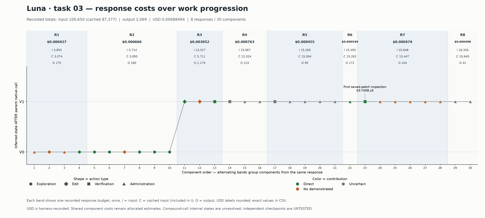

# Luna task 03: complete four-label contribution review

**All 30 components now have v2 labels; legacy unsplit = 0.** Five prior v2 judgments are carried forward and 25 are newly reviewed, including all eight remaining legacy cases. The original 20-case/four-run study and its labels are untouched. Action roles and execution-status tags are retained from the prior annotation; this completion reviews contribution labels. This is retrospective, unblinded model review by Codex (model identifier unavailable), not human validation.

| Category | Count |
| --- | ---: |
| Direct | 10 |
| Indirect | 0 |
| No demonstrated contribution | 10 |
| Uncertain | 10 |
| Legacy unsplit | 0 |

Direct precision: **33.3%–66.7%**, using all 30 candidates under the archived execution convention. The 22 confirmed-executed components give **45.5%–54.5%** as a separate execution sensitivity. Eight components have uncertain execution; two invoked tests have uncertain outcomes. Label bounds are not confidence intervals.

| Role | N | D | I | Z | U | Direct bounds |
| --- | ---: | ---: | ---: | ---: | ---: | --- |
| exploration | 8 | 6 | 0 | 2 | 0 | 75.0%–75.0% |
| edit | 2 | 1 | 0 | 1 | 0 | 50.0%–50.0% |
| verification | 4 | 2 | 0 | 0 | 2 | 50.0%–100.0% |
| administration | 16 | 1 | 0 | 7 | 8 | 6.2%–56.2% |

No indirect example is supported in this run. In particular, Y001–Y003 were emitted together: their chronological execution alone cannot prove one result guided generation of the next call. A later direct dependency must be demonstrated before assigning indirect. Uncertain results are not forced into the non-contributing category.

Y007.c0 changes from legacy non_direct to direct: it creates the specifically required submission artifact, which Y008 then inspects. Separators, the unused dependency inventory, repeated header support and an unsupported extra whitespace check receive no_demonstrated. Y005/Y006 timeouts provide no established test pass, so the retry is uncertain rather than proven repeated-support over-verification.

Resources are unchanged: **100,650 input / 87,377 cached input / 2,069 output tokens**, harness-recorded response cost **$0.00688494** across eight responses. Cache is included in input. Component shares remain explicitly allocated estimates when a response generates several components. No raw run total was distributed to fill missing usage.

## Annotation implementation

1. Decompose native calls into meaningful work components, retaining parent action, generating response, order and execution uncertainty. Do not credit a compound call as a whole.
2. Read task requirements, the actual agent-visible observations, subsequent performed work and final patch. The final patch is evidence, not an exact-template reference; unchanged source and alternative valid fixes can contribute. Hidden/elided output receives no credit.
3. Assign one contribution label independently of action role: direct establishes relevant facts/changes/checks; indirect needs an observed decision/dependency to later performed direct work; no_demonstrated means no supported contribution in available evidence; uncertain records a specific missing result/state/link.
4. Save model identity, evidence, requirement links, command SHA256, reason, property/state/prior-check details and any indirect-support IDs in an additive overlay. Original labels remain archived_contribution_label. Five existing reviews retain their original provenance.
5. worktrace.contributions.apply_reviews checks IDs, command hashes, nonempty provenance/evidence and label vocabulary. For indirect links it enforces same run, later order, direct label and not known unexecuted. These are structural checks; the reviewer must still establish actual performance and a semantic dependency.
6. contribution_score excludes known unexecuted candidates and returns D/N to (D+U)/N. Indirect and no_demonstrated get no direct credit. Uncertain execution remains explicit, with a confirmed-execution sensitivity. Empty roles are undefined.
7. worktrace.resources.allocate_usage divides each recorded response budget across all emitted components from that response; no component is dropped for being unhelpful or unexecuted. It preserves separate input/cache/output/USD, missing values, no-tool expenditure and conservation. This script asserts every component allocation equals the previous ledger exactly.
8. Code-state placement is inferred at parent-call boundaries. Contribution, execution, token allocation and independent benchmark outcomes remain separate. No PASS or post-pass savings is inferred from these labels.

The complete evidence and original/reviewed labels are in [component_table.csv](component_table.csv), with machine-readable reviews in [contribution_review_completed.jsonl](contribution_review_completed.jsonl). Task requirements, original prompt delivery rules and final patches are preserved in the [prior context](../framework_one_hour_run_20261027_0230/task_context.md). Focused annotation/resource regression results are in [checks.txt](checks.txt).
