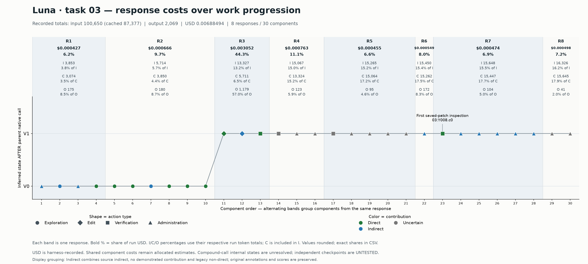
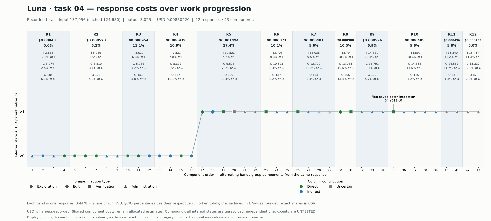

# Luna response-cost bands

Real saved trajectories from the four-run smoke study, with one alternating band
per stored model response. The horizontal axis remains component order. Each
band spans all candidate components generated by that response and displays the
response's recorded dollar amount and input/cache/output tokens **once**.
The bold percentage below each dollar amount is that response's share of total
recorded run USD. Input/cache/output percentages use their respective run token
totals, not dollars; these percentages are separate views and must not be added
together. Each set of unrounded band shares sums to 100% for the complete runs.

- Task 03: eight response bands and 30 components.
- Task 04: twelve response bands and 43 components.
- Shape encodes action type; solid color encodes contribution.
- The default display merges source indirect, no demonstrated contribution and
  legacy non-direct into **Indirect** (blue), with direct green and uncertain
  gray. This is a display grouping; original annotations and precision scores
  are preserved. `component_display_labels.csv` records the explicit mapping.
  Use `--contribution-view detailed` to reproduce the finer source categories.
- I includes cached input C. Do not add C to I again.
- USD is harness-recorded expenditure; plot labels are rounded to six decimals.
- These are measured response budgets. They do not measure each component's
  internal reasoning cost. Shared component shares remain allocated estimates.
- States remain inferred after the parent native call; no new checkpoint
  evaluation or contribution review was performed for this plot.





Exact unrounded response budgets and band membership are in
`response_band_totals.csv`, including `cost_percent_of_run`,
`input_percent_of_run`, `cached_input_percent_of_run` and `output_percent_of_run`.
Missing or zero denominators produce an unavailable percentage, not 0%.
Input hashes are in `manifest.json`. Source experiment:
`results/framework_one_hour_run_20261027_0230/`.

Reproduce from the repository root with Matplotlib:

```bash
python scripts/followup/draw_response_cost_bands.py \
  --out results/response_cost_bands_20261027
```

The plotting script checks that all three token totals and recorded dollar totals
match the source run records. It rejects missing or non-contiguous response groups
rather than losing an unassigned response budget.
